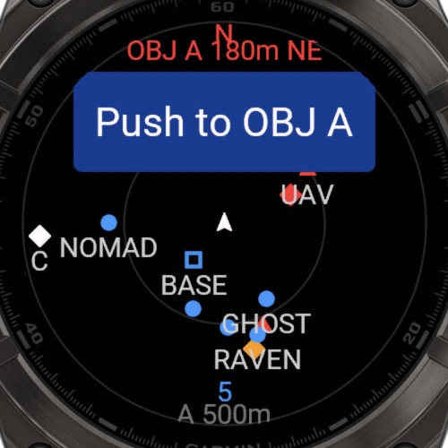
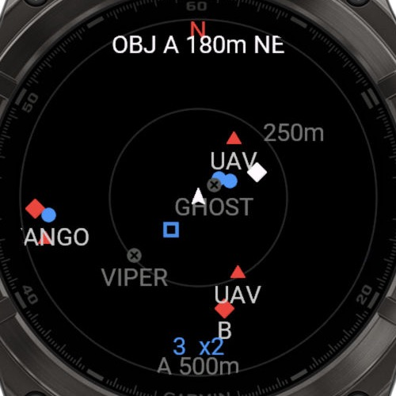
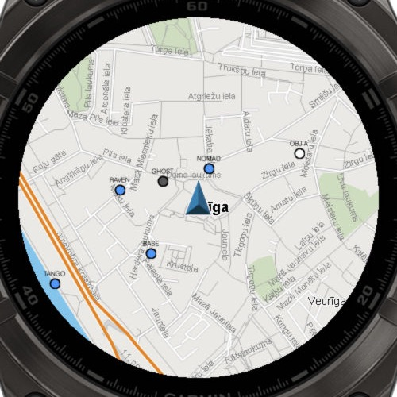
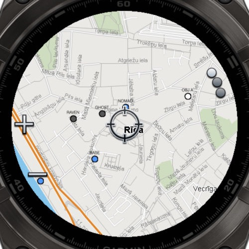
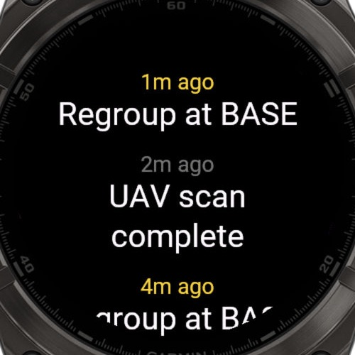
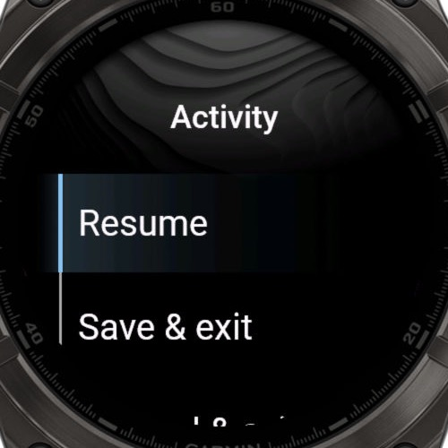
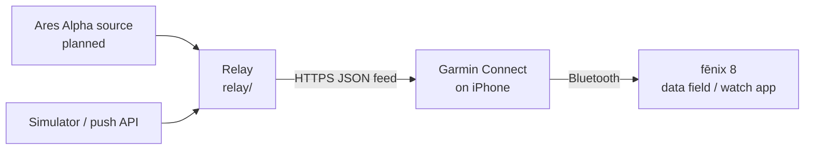

# ares-garmin

Shows Ares Alpha team data (team positions, enemies, objectives and orders) from the
iPhone on a Garmin fēnix 8 AMOLED. It includes:

- **AresRadar**, a Connect IQ data field that adds a radar screen to any native activity.
- **Ares Map**, a watch app with the radar, a Garmin map with markers, a message list
  and activity recording.
- **Relay**, a small Node.js server that turns team data into a compact feed for the
  watch. Until the Ares Alpha source is implemented, it serves simulated team data.

| Data field (native activity) | Watch app: radar | Watch app: map |
|---|---|---|
|  |  |  |
| **Map browse mode (pan/zoom)** | **Messages** | **Activity menu** |
|  |  |  |

*Screenshots are from the Connect IQ simulator (fēnix 8 47mm), with the relay serving
simulated data.*

## How it works



The watch polls the relay about every 5 s, sending its own position. Requests go
through the Garmin Connect app on the phone, so the relay must be reachable over
**publicly trusted HTTPS**; a `cloudflared` tunnel works. A second transport, an iOS
companion app talking to the watch directly, is planned. Feed format:
[docs/PROTOCOL.md](docs/PROTOCOL.md).

Ares Alpha has no public API. The real data source (`relay/src/sources/ares.js`) is a
placeholder until the app's traffic is reverse-engineered.

## Repository layout

| Path | Contents |
|---|---|
| `relay/` | Node.js relay: simulated source, push API, debug map at `/`, tests |
| `watch/common/` | Shared Monkey C: feed model, geo helpers, link/polling, radar renderer, settings |
| `watch/datafield/` | AresRadar data field |
| `watch/app/` | Ares Map watch app |
| `scripts/build.sh` | Builds the watch projects with the relay URL and key compiled in |
| `docs/` | Protocol, project status, watch setup, screenshots |

## Quick start (simulator)

Prerequisites (macOS):

- Node.js 20 or later.
- The [Connect IQ SDK Manager](https://developer.garmin.com/connect-iq/sdk/), with
  SDK 9.x and the fēnix 8 device profiles.
- A 4096-bit developer key and `cloudflared` (`brew install cloudflared`).

Setup details are in [docs/WATCH_SETUP.md](docs/WATCH_SETUP.md).

```sh
# 1. Relay with simulated team data around Riga
cd relay && RELAY_KEY=devkey SIM_ANCHOR=56.9496,24.1052 node src/main.js
# 2. Public HTTPS URL for it (in another terminal; the URL changes on every restart)
cloudflared tunnel --url http://localhost:8787
# 3. Build with that URL. SIM_POS gives debug builds a position when there is no GPS.
RELAY_URL=https://<x>.trycloudflare.com RELAY_KEY=devkey SIM_POS=56.9496,24.1052 DEBUG=1 \
  scripts/build.sh all fenix847mm
# 4. Run in the simulator
SDK="$(cat ~/Library/Application\ Support/Garmin/ConnectIQ/current-sdk.cfg)"
"$SDK/bin/connectiq" &
"$SDK/bin/monkeydo" build/AresMap.prg fenix847mm     # or build/AresRadar.prg
```

Open `http://localhost:8787/?k=devkey` to see the relay's debug map. Run the relay tests
with `cd relay && npm test`.

## Watch app controls

| Screen | START | UP / DOWN | BACK | Long-press UP (menu) |
|---|---|---|---|---|
| Radar | Start or pause recording | Zoom in / out | Activity menu while recording, otherwise exit | Map, messages, record, heading-up, auto range |
| Map | Browse mode (pan/zoom) | — | Leave browse mode / back to radar | — |
| Messages | — | Scroll | Back to radar | — |

## Status

See [docs/STATUS.md](docs/STATUS.md) for verified state, known issues and next steps.
Agents working in this repository follow [AGENTS.md](AGENTS.md).
